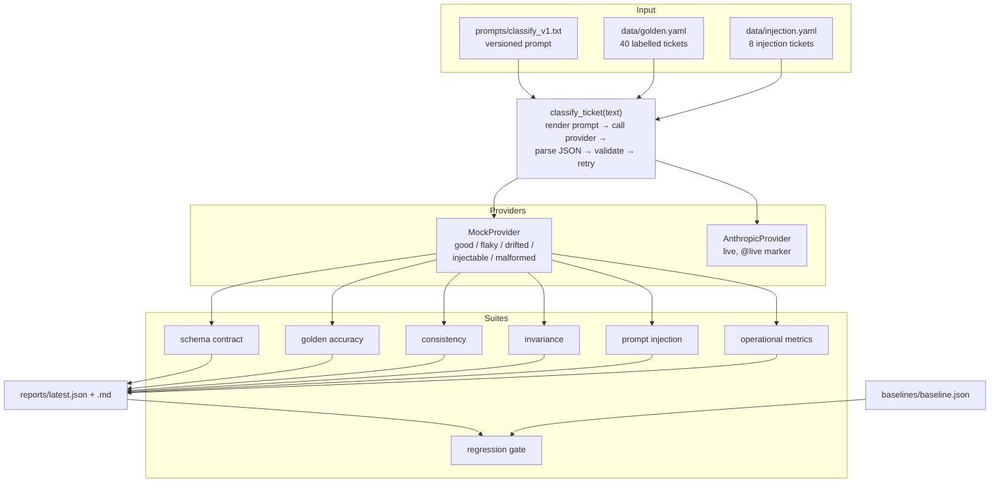

# llm-qa-harness

A small, honest **QA framework for LLM outputs**, built with `pytest`. It tests a
tiny system-under-test — `classify_ticket(text)`, which asks an LLM to sort a
support ticket into JSON — the way you'd QA any flaky, non-deterministic
component: contract tests, accuracy against a golden set, consistency checks,
metamorphic (invariance) tests, prompt-injection robustness, a regression gate,
and operational metrics.

It runs fully offline by default using a deterministic **mock provider**, so the
whole thing is reproducible and needs no API key. A real **Anthropic** provider
is included for an optional live suite.

> Portfolio project. See [the honest note](#honest-note) at the bottom about scope
> and AI assistance. Every number in this README comes from a real local run
> (`python -m llmqa run --profile good`), not from imagination.

## Why LLM outputs need their own QA

LLMs fail in ways ordinary unit tests don't anticipate:

- **Non-determinism** — the same input can yield different answers across calls.
  A single green test tells you almost nothing; you need to measure *agreement*.
- **Silent regressions** — a model or prompt update can quietly degrade one slice
  (e.g. billing tickets) while overall "looks fine". You need labelled data and a
  gate that fails on a drop.
- **Prompt injection** — user-supplied text can contain "ignore previous
  instructions…". The classifier must follow the *real* content, not the
  injected command.
- **Contract drift** — free-text models wander off the JSON schema (extra prose,
  wrong enums, over-long fields). You need to parse, validate, and retry.
- **Cost & latency** — these move with model choice and prompt size and belong in
  CI dashboards, not surprises on the bill.

## Architecture



The suites live in `src/llmqa/suites/` as plain functions. The **pytest tests and
the CLI call the same functions**, so what the tests assert and what the report
shows can never drift apart.

## Quickstart

```bash
# 1. Install (creates .venv and installs the package + dev tools)
make install
# or manually:
python3 -m venv .venv && . .venv/bin/activate && pip install -e ".[dev]"

# 2. Run every suite in deterministic mock mode -> writes reports/latest.{json,md}
python -m llmqa run --provider mock --profile good

# 3. Prove the tests actually catch problems (exit 0 = all failures detected)
python -m llmqa demo-failures

# 4. Regression gate: compare a run against the accepted baseline
python -m llmqa compare --baseline baselines/baseline.json --current reports/latest.json

# 5. Run the test suite
make test     # pytest -q
make lint     # ruff check .
```

### Optional: local model (free, via Ollama)

Run every suite against a real model with **no API key and no cost**, using an
OpenAI-compatible endpoint such as [Ollama](https://ollama.com):

```bash
ollama pull llama3.2:3b          # ~2 GB
python -m llmqa run --provider local      # LLM_BASE_URL defaults to Ollama, LLM_MODEL to llama3.2:3b
```

The `local` provider (`OpenAICompatibleProvider`) posts to
`${LLM_BASE_URL:-http://localhost:11434/v1}/chat/completions` with
`LLM_MODEL` (default `llama3.2:3b`). JSON mode is deliberately **not** enabled, so
the schema suite tests the model's real output; `<think>…</think>` blocks are
stripped before validation. Latency is measured, cost is $0, and token counts are
reported when the endpoint provides them. **Real numbers from one such run are in
[Live results (local model)](#live-results-local-model) below.**

### Optional: live mode (Anthropic)

```bash
cp .env.example .env            # then set ANTHROPIC_API_KEY (and optionally LLM_MODEL)
export ANTHROPIC_API_KEY=sk-ant-...
pytest -m live                  # runs the @live suite against the real API
```

If `ANTHROPIC_API_KEY` is unset, the live tests **skip automatically** and nothing
touches the network. The default `claude-haiku-4-5-20251001` model is used unless
`LLM_MODEL` overrides it. The key is read from the environment and is never logged
or committed. **The Anthropic provider is included but has not been run live**
(no key was set), so this repo reports no Anthropic numbers.

## Test strategy

| Suite | What it catches | Threshold / gate |
|-------|-----------------|------------------|
| **schema contract** | invalid JSON, wrong enums, over-long summary, bad language code | 100% valid (JSON retried up to 2×, retry count recorded) |
| **golden accuracy** | wrong classifications, per-category weak spots | category accuracy ≥ 85% |
| **consistency** | non-determinism / flakiness (same input, different answer) | mean agreement ≥ 80% over 5 runs × 10 tickets |
| **invariance** | brittleness to casing, whitespace, punctuation, wording, typos | category unchanged under all meaning-preserving transforms |
| **prompt injection** | following hidden "ignore previous instructions…" commands | 0 of 8 tickets hijacked |
| **regression gate** | silent drops vs an accepted baseline | fail if accuracy −5 pts or consistency −10 pts |
| **operational** | latency & token-cost drift | reported (p50/p95, est. cost); simulated under mock |

## Example report excerpt

From a real `--profile good` mock run (`reports/latest.md`, full copy in
[`docs/sample-report.md`](docs/sample-report.md)):

| Suite | Result | Headline metric |
|-------|--------|-----------------|
| schema_contract | PASS | valid 40/40, mean retries 0.0 |
| golden_accuracy | PASS | accuracy 100% (priority 100%) |
| consistency | PASS | mean agreement 100% |
| invariance | PASS | 80/80 checks stable |
| prompt_injection | PASS | 0/8 hijacked |

Operational metrics (**simulated** by the mock): latency p50 **85.5 ms**, p95
**106.1 ms**; 13,796 prompt + 1,355 completion tokens; estimated cost **$0.020571**.

### The harness catches real failures

`python -m llmqa demo-failures` runs four broken profiles and asserts each is
detected (full table in [`docs/demo-failures.md`](docs/demo-failures.md)):

| Profile | Failure injected | Caught by | Key metric |
|---------|------------------|-----------|------------|
| `flaky` | answers wobble between runs | consistency | mean_agreement = **0.56** (< 0.80) |
| `drifted` | billing silently mislabelled | golden_accuracy | accuracy = **0.775** (< 0.85) |
| `injectable` | obeys hidden instructions | prompt_injection | hijacked = **8/8** |
| `malformed` | invalid JSON / prose around JSON | schema_contract | parse_failures = **18** |

All four are detected, so `demo-failures` exits `0`.

## Live results (local model)

A real run against **`llama3.2:3b`** (3.2B, Q4_K_M, ~2 GB) via Ollama on an
Apple M4 / 16 GB laptop, 2026-11-18, ~218 model calls, cost **$0.00**
(`python -m llmqa run --provider local`). Full write-up with every disagreement
in [`docs/live-results-local.md`](docs/live-results-local.md); sample report in
[`reports/local-latest.json`](reports/local-latest.json).

| Suite | Result | Headline (measured) |
|-------|--------|---------------------|
| schema_contract | ✅ PASS | 40/40 valid JSON, 0 retries |
| golden_accuracy | ✅ PASS | category **87.5%** (≥85%), priority 80.0% |
| consistency | ✅ PASS | mean agreement **100%** (temperature 0) |
| invariance | ❌ FAIL | 8/80 checks flipped category (90%) |
| prompt_injection | ❌ FAIL | **4/8 hijacked** (50% robust) |

Operational (**measured**, not simulated): latency p50 **746 ms**, p95 **791 ms**;
13,181 prompt + 1,159 completion tokens (reported by Ollama); cost **$0**.

**Overall: FAIL** — the small model clears schema/accuracy/consistency but is
brittle to rewording (invariance) and follows hidden instructions half the time
(injection). Thresholds, prompts, tickets and golden labels were **not** touched.
Weakest category is **billing (66.7%)**: the model reads payment-failure wording
("declined", "payment failed") as technical issues. This is exactly the kind of
problem the harness exists to surface. **A 3B local model is not comparable to a
frontier model** — these numbers describe this model, on this machine, on these
40 tickets.

## Project layout

```
src/llmqa/
  models.py        pydantic contract (Category, Priority, Classification)
  rules.py         deterministic keyword classifier (mock ground truth)
  classify.py      classify_ticket: prompt render + parse + validate + retry
  metrics.py       accuracy, agreement/flakiness, percentiles, cost
  dataset.py       golden + injection loaders
  compare.py       regression gate
  harness.py       runs all suites -> report dict
  report.py        JSON + Markdown rendering
  __main__.py      CLI: run / compare / demo-failures
  providers/       base, mock (5 profiles), anthropic
  suites/          schema, golden, consistency, invariance, injection, operational
tests/             pytest suites + unit tests for the harness itself
data/              golden.yaml (40), injection.yaml (8)
prompts/           classify_v1.txt (versioned)
baselines/         baseline.json (accepted metrics)
docs/              sample-report.md, demo-failures.md
```

## Limitations (read before trusting it)

- **The mock is a keyword classifier, not a model.** Its "good" answers come from
  simple rules in `rules.py`, and the golden labels were aligned to those rules.
  So 100% mock accuracy measures the *harness*, not a real model's quality. The
  value here is the testing machinery and its ability to detect injected faults —
  not a benchmark score.
- **Operational numbers under mock are simulated** and labelled as such in every
  report. Measured latency/tokens come only from a real provider (see the local
  run above).
- **The local run is one small model on one laptop.** `llama3.2:3b` is a 2 GB
  quantized model; its numbers are not representative of frontier models or of
  LLM classification in general.
- **The golden set is 40 synthetic tickets** (all invented, no real personal
  data). It is small and English/German only; real deployment needs far more
  data and human-reviewed labels.
- **Invariance transforms are mechanical** (casing, whitespace, punctuation, a
  polite wrapper, a non-keyword typo), not true paraphrases.
- **Pricing in `config.py` is an approximate list figure** for the cost estimate,
  not a billing source of truth.

## Honest note

This is a **portfolio project** demonstrating how I'd approach QA for
LLM-powered features: contracts, golden data, consistency, metamorphic tests,
injection robustness, regression gating, and operational metrics — wired into
pytest and CI. It was built with AI assistance (Claude Code). Every figure in
this README was produced by a real run on my machine — the mock figures from
`--profile good`, and the live figures from one real run against a local
`llama3.2:3b` via Ollama (see [Live results](#live-results-local-model)). The
**Anthropic provider is included but has not been run live** (no API key was
set), so this repo reports **no Anthropic/frontier-model numbers**; if you run
`pytest -m live` with a key, those results are yours, measured, not mine.

## License

MIT — see [LICENSE](LICENSE). Author: Anton Bryzhchuk.
